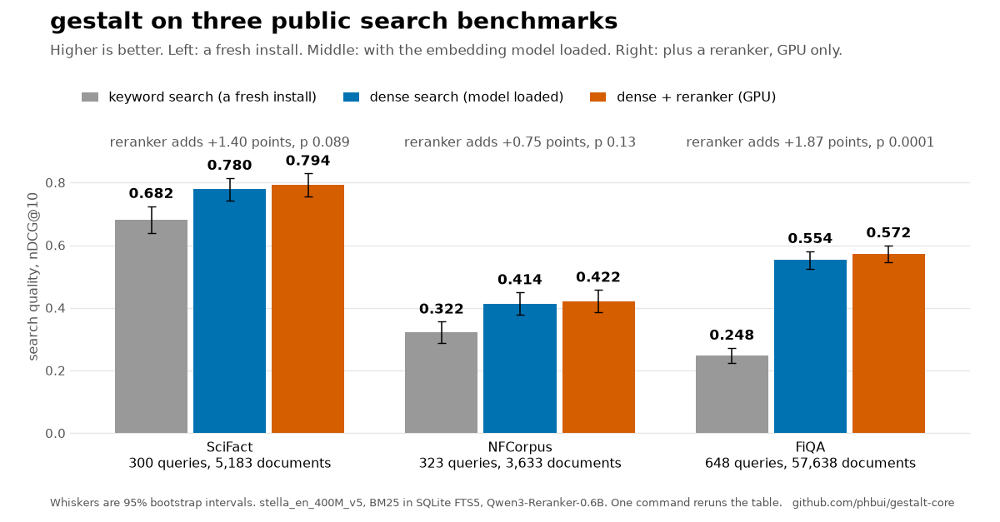
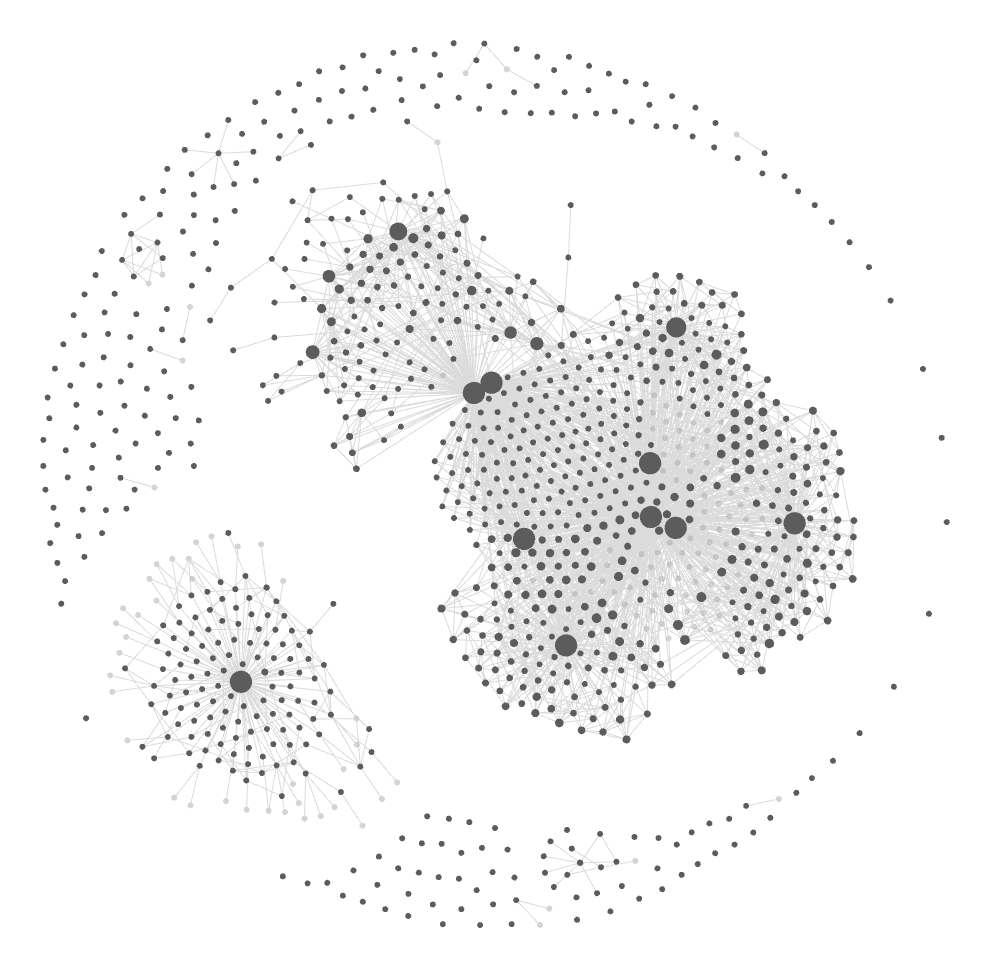
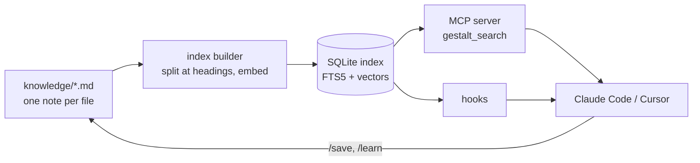
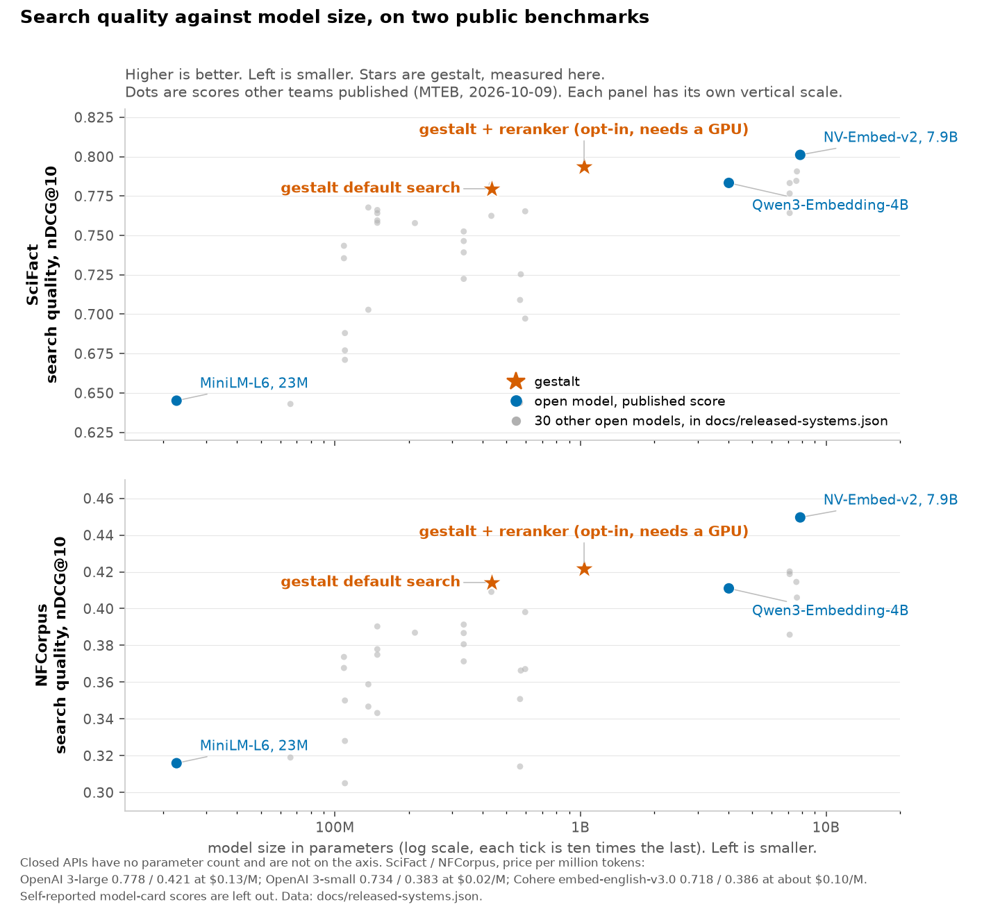
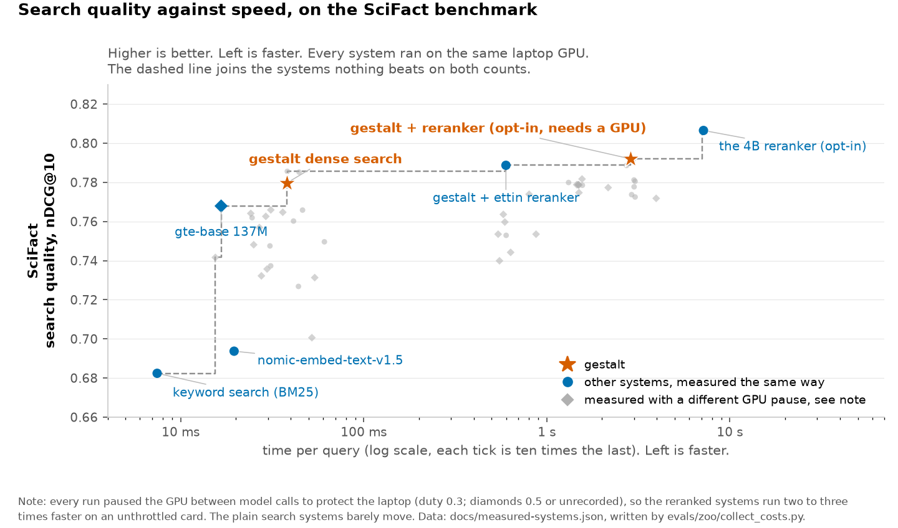
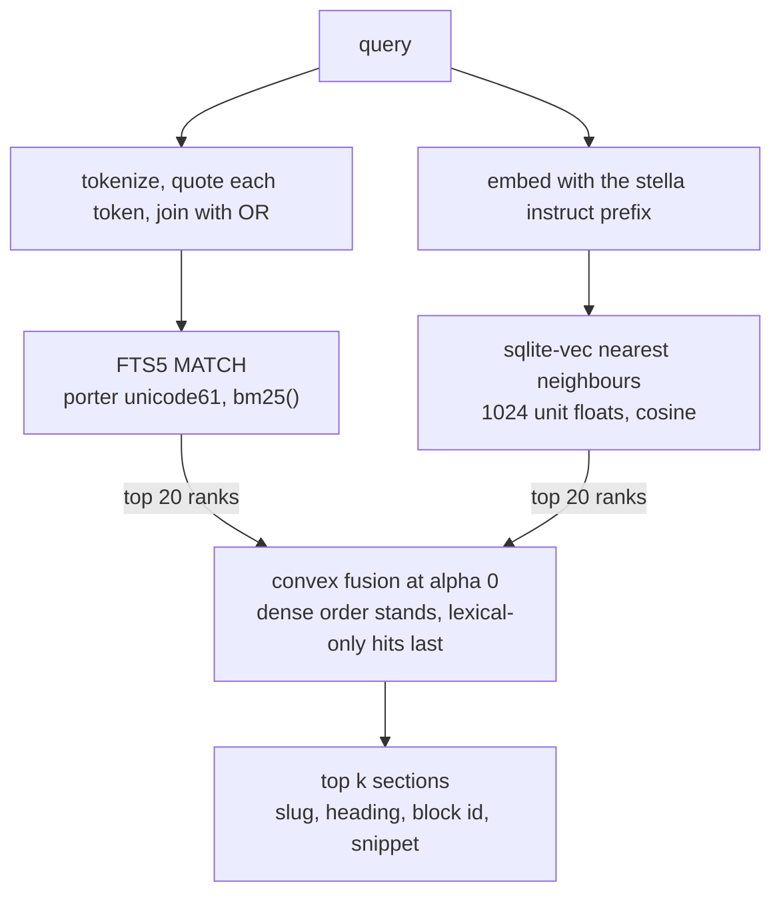
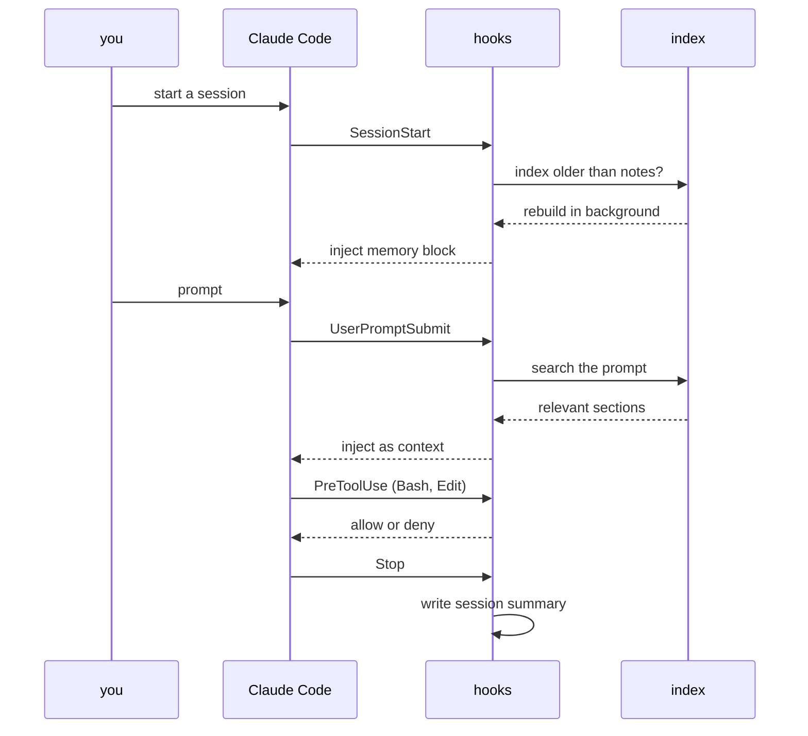

# gestalt-core

[](https://github.com/phbui/gestalt-core/actions/workflows/ci.yaml)
[](LICENSE)
[](#install)
[](evals/retrieval/BENCHMARKS.md)
[](evals/retrieval/BENCHMARKS.md)
[](evals/retrieval/BENCHMARKS.md)

**Local search over your Markdown notes for Claude Code and Cursor, with BEIR numbers you can rerun.** Notes in, the right section back at the right moment. A stella_en_400M_v5 dense leg in SQLite with sqlite-vec, full-text BM25 as the lexical fallback, an optional cross-encoder rerank blended with the dense order, and hooks that put what matters in front of the agent at session start and before each prompt. Nothing leaves your machine and nothing needs an API key. Every published number comes from a harness that reproduces it from a clean checkout.

A gestalt is a whole whose meaning exceeds the sum of its parts. Scattered notes become a gestalt when a system recalls the right note at the right moment, so that each session of a coding agent starts with everything the previous sessions learned. I built it for my own work and I use it every day for personal, school, and research related thinking.

On three public BEIR benchmarks the shipped pipeline scores 0.794 nDCG@10 on SciFact, 0.422 on NFCorpus and 0.572 on FiQA. The dense leg alone, which runs on a CPU, scores 0.780, 0.414 and 0.554, and keyword search scores 0.682, 0.322 and 0.248. One command reruns the table. The intervals, the tests and the comparison with released systems are in [Benchmarks](#benchmarks).





*A screenshot from my Obsidian notes.*

## Why

A coding agent forgets what it learned when the session ends. A memory file carries a page of it forward, and a thousand notes do not fit in a page. Gestalt keeps the notes as the source of truth, in Markdown you own and edit, and puts the right section in front of the agent when it is needed. The index is one SQLite file on your disk. [QMD](https://github.com/tobi/qmd) runs the same three stages, BM25, vectors and a reranker, as a command-line search. Gestalt adds the hooks that feed an agent and the harness that scores the search on public data, so you can check the numbers before you trust them.

## Features

- **Dense search** over your notes: stella_en_400M_v5 vectors in sqlite-vec, with FTS5 BM25 as the lexical leg for a machine without the model, in one SQLite file. No service to run.
- **Optional reranking** with Qwen3-Reranker-0.6B at depth 40, blended half and half with the dense order, the headline configuration: 0.794 nDCG@10 on SciFact, 0.422 on NFCorpus and 0.572 on FiQA.
- **Agent integration**: an MCP server (`gestalt_search`), session-start and per-prompt hooks, slash commands such as `/save` and `/learn`, for Claude Code and Cursor.
- **Honest measurement**: bootstrap intervals, paired permutation tests, sealed held-out sets, a release gate that ties every published number to the hashes of the code that produced it, and `reproduce.py`, which rebuilds the headline table and checks every cell.
- **Runs on a laptop**: the lexical leg on a CPU in about 25 ms a query, the dense leg in about 190 ms, and the reranked pipeline on one consumer GPU in half precision at about 2 GB.
- **Knobs for the long tail**: abstention from a calibrated reranker score, wikilink expansion, supersession and freshness demotion, all off by default.




## Install


Python 3.11 or newer is required. Lexical search needs neither a model nor a GPU.

```
git clone https://github.com/phbui/gestalt-core
cd gestalt-core
python3 -m venv .venv && . .venv/bin/activate
pip install -r tools/requirements.txt pytest
export GESTALT_PYTHON="$(which python3)"
python3 tools/gestalt-index-builder.py --fts-only
bash tools/gestalt search "merge two ranked lists"
python3 evals/retrieval/run_retrieval_evals.py --mode fts
python3 -m pytest tests -q
```

The search prints `sample-rank-fusion` sections. The golden-set run prints recall and MRR over the sample notes and says that lexical-only numbers are never banked. The test run passes, and some tests skip on a fresh clone.

- **No GPU.** Install torch from the CPU index first, so pip does not pull the CUDA wheels: `pip install --index-url https://download.pytorch.org/whl/cpu torch`.
- **Benchmarks.** Install `evals/retrieval/requirements-bench.lock` instead of the requirements file. It holds the exact versions that produced the stored numbers. See BENCHMARKS.md, Install.
- **Skipped harness tests.** The bench tests skip until those requirements are installed, and a green run that skipped them has not checked the harnesses.

The five `sample-*.md` files in `knowledge/` are synthetic and exist so that the index, the search and the golden set run on a fresh clone. Delete them and add your own notes. Omitting `--fts-only` builds the dense vectors as well, which downloads the embedding model and benefits from a GPU.

Claude Code reads `.claude/` in the directory it is launched from. To install the hooks, link that directory's entries to `claude-tree/`. Read `claude-tree/settings.json` first, because it replaces the settings that directory had.

```
mkdir -p .claude
ln -s ../claude-tree/hooks .claude/hooks
ln -s ../claude-tree/rules .claude/rules
ln -s ../claude-tree/skills .claude/skills
ln -s ../claude-tree/settings.json .claude/settings.json
```

The optional memory services are defined in `docker-compose.yml` and `graphiti/`. The compose file binds their ports to `127.0.0.1`. None of the services authenticates requests, so their ports must stay off the network.

## Benchmarks


Retrieval quality was measured on three public benchmarks from the BEIR collection. A benchmark supplies a fixed corpus and a set of queries with known relevant documents, and scores how high the relevant documents rank. No default of gestalt was chosen on any of them. The optional fusion weights are tuned on a dev half of the queries and reported apart from the headline.

**The datasets.** SciFact contains 5,183 scientific abstracts and 300 test claims, each supported or refuted by one or two abstracts. NFCorpus contains 3,633 medical abstracts and 323 questions phrased in everyday language, each with many relevant abstracts graded by relevance. FiQA-2018 contains 57,638 answers from financial discussion forums and 648 questions, each answered by a few of them. Every published system scores lower on NFCorpus than on SciFact, because its questions and abstracts share few words. FiQA sits between the two for most systems, and it is where BM25 falls furthest behind, at 0.248 against 0.554 for the dense leg.

**The metric.** nDCG@10 scores the first ten results. A relevant document in first place earns full credit, and the same document in tenth place earns roughly one third. The sum is divided by the credit of a perfect ranking, so 1.000 means every relevant document sits at the top in the right order, and 0.000 means none appears in the first ten. A score of 0.780 therefore captures that fraction of the credit a perfect ranking would earn, averaged over the 300 queries.

**Gestalt's systems.** The BM25 leg is the full-text search alone. The dense leg is the vector search alone, and under the shipped profile it is also what `gestalt_search` returns without a reranker: the fusion is convex at alpha 0, so the dense order stands and a lexical-only hit scores below every dense hit. The lexical leg had lowered every strong dense leg on three BEIR sets, so it casts no vote. The reranked system re-scores the top 40 dense hits with the cross-encoder and blends that score half and half with the dense score. Each cell reports the mean over queries with a 95% bootstrap interval, the range the mean would cover under repeated draws of the query set.

| Dataset | BM25 leg | Dense leg, the default search | Dense + reranker |
|---|---|---|---|
| SciFact, 300 queries | 0.682 [0.638, 0.725] | 0.780 [0.742, 0.815] | **0.794 [0.757, 0.830]** |
| NFCorpus, 323 queries | 0.322 [0.287, 0.356] | 0.414 [0.378, 0.450] | **0.422 [0.386, 0.458]** |
| FiQA, 648 queries | 0.248 [0.224, 0.273] | 0.554 [0.526, 0.581] | **0.572 [0.545, 0.600]** |

The reranked row is the headline. It is what `--rerank on` gives you: the hybrid's top 40 candidates re-scored by `Qwen/Qwen3-Reranker-0.6B` with a task line per dataset, recorded in `results/summary.json`. The hybrid row is the default on a machine without a GPU.

**Which gains the tests confirm.** A paired permutation test compares two systems on the same queries and reports how often a random relabelling of the paired differences produces a gap at least as large as the observed one.

| Comparison | SciFact | NFCorpus | FiQA |
|---|---|---|---|
| Dense leg minus BM25 leg | +0.097, p < 0.0001 | +0.092, p < 0.0001 | +0.305, p < 0.0001 |
| Dense + reranker minus dense leg | +0.014, p = 0.089 | +0.007, p = 0.13 | +0.019, p < 0.0001 |

The conventional threshold is p < 0.05. The dense leg's gain over BM25 clears it on all three sets by a wide margin. The reranker's gain over the dense leg clears it on FiQA, 1.9 points at p 0.0001, and does not on SciFact, 1.4 points at p 0.09, or on NFCorpus, under a point at p 0.13. So the two scientific sets do not separate the reranked system from the dense leg, and FiQA, where BM25 trails the dense leg by thirty points, is where the reranker earns its place.

**Comparison with released systems.** The table lists the systems most people use, the ones that compete with gestalt in size or score, and the baselines from the BEIR paper. It is sorted by SciFact score. Scores are the MTEB results repository's own per-task numbers from 2026-10-09. Those are the BEIR test splits at nDCG@10, each model's own run with its own prompts. The gestalt rows are measured here. FiQA is not in this table: the published rows were collected for the two sets the comparison began with. The full data file, with 40 systems and their licences, memory and prices, is `docs/released-systems.json`, and the method page has the longer table.

| System | Type | Parameters, or price | SciFact | NFCorpus |
|---|---|---|---|---|
| NV-Embed-v2 | dense | 7.8B | 0.801 | 0.450 |
| **gestalt dense + Qwen3-Reranker-0.6B** | dense, cross-encoder blend | 435M + 0.6B | **0.794** | **0.422** |
| Qwen3-Embedding-4B | dense | 4.0B | 0.783 | 0.411 |
| stella_en_400M_v5 | dense | 435M | 0.782 | 0.415 |
| **gestalt dense leg, stella_en_400M_v5 served here** | dense | 435M | **0.780** | **0.414** |
| OpenAI text-embedding-3-large | dense API | $0.13/M | 0.778 | 0.421 |
| gte-base-en-v1.5 | dense | 137M | 0.768 | 0.359 |
| gte-modernbert-base | dense | 149M | 0.764 | 0.343 |
| bge-large-en-v1.5 | dense | 335M | 0.746 | 0.381 |
| bge-base-en-v1.5 | dense | 109M | 0.743 | 0.374 |
| OpenAI text-embedding-3-small | dense API | $0.02/M | 0.734 | 0.383 |
| nomic-embed-text-v1.5 | dense | 137M | 0.703 | 0.347 |
| BM25 + cross-encoder, BEIR paper | two stage | 110M | 0.688 | 0.350 |
| Contriever | dense | 110M | 0.677 | 0.328 |
| ColBERT, BEIR paper | late interaction | 110M | 0.671 | 0.305 |
| BM25, BEIR paper | lexical | none | 0.665 | 0.325 |
| all-MiniLM-L6-v2 | dense | 23M | 0.645 | 0.316 |
| TAS-B | dense | 66M | 0.643 | 0.319 |
| DPR | dense, 2020 | 220M | 0.318 | 0.189 |



On SciFact the reranked pipeline scores above Qwen3-Embedding-4B, above stella alone and above OpenAI's text-embedding-3-large, and under NV-Embed-v2 at 7.8B parameters and the self-reported gte-large score. On NFCorpus it is level with OpenAI's large embedding and under NV-Embed-v2, and above stella alone by the reranker's margin. What gestalt offers is two models of about a billion parameters together, a 435M embedder and a 0.6B reranker, on one laptop GPU, and the dense leg alone runs on a CPU. It does not claim the top of either leaderboard. The 4B reranker adds another point and a half at three times the latency and is an opt-in, and the zoo measures every candidate on the same queries.

Against the closest published design, BM25 with a cross-encoder reranker, the dense leg alone lies above the published scores on both sets, 0.688 and 0.350, with its whole interval.



The second chart is the same machine for every row, so the latencies compare. It shows SciFact, and the benchmark page has all three sets. The dense leg sits on the frontier of every set at under 130 ms a query. The shipped pipeline sits on it too, two to three seconds a query under the GPU duty cycle the runs used, and the 4B reranker is the only measured system above it, at two to three times the latency and 11 GB of VRAM. `docs/measured-systems.json` holds every row with its duty cycle, and `evals/zoo/README.md` says how to add a system.

**Scope of the result.** The measurement establishes that the pipeline is sound, that the dense leg beats BM25 on every set, and on which sets the reranker's gain is real. It does not establish that gestalt outperforms a strong retriever, and it says nothing about retrieval over personal notes, whose structure differs from scientific abstracts and forum answers. The method, the limits and the one-command reproduction are in [evals/retrieval/BENCHMARKS.md](evals/retrieval/BENCHMARKS.md). Per-query scores and run files are in `evals/retrieval/results/`.

### Reproduce


`evals/retrieval/BENCHMARKS.md` is the full guide. It gives the install, the smoke, standard and full commands for BEIR, MTEB, LongMemEval and LoCoMo, how to resume and shard a run, the disk and GPU cost, and the licence of every dataset. One command rebuilds the headline table from the stored summary and checks every cell:

```
python3 evals/retrieval/check_env.py
python3 evals/retrieval/reproduce.py --out out/beir-repro
```

Add `--smoke` for a 200-document run that proves the code works, and `--fast` to embed in float16. On a machine without CUDA the preflight ends in NO-GO. That is expected. The smoke run still works there with `GESTALT_BENCH_ALLOW_CPU=1`, and only a GPU run produces numbers. A run labelled subset or smoke is never a result.

## What it is not

It is not a hosted service and it has no cloud. It does not write extracted facts into your notes. Every write goes to an inbox a person reviews. It is not a leaderboard entry. The numbers above are two small scientific datasets, and a bigger embedder beats the dense leg. The comparisons stop where the reruns stop. The benchmark pipeline downloads datasets with their own terms, and some of them, NFCorpus and LoCoMo among them, allow academic or non-commercial use only. The code is Apache-2.0. The pipeline as a whole is not a commercial-use claim, and `THIRD-PARTY-NOTICES.md` lists each dataset's terms.

## What ships on, and what you opt in to

The defaults are what the headline table measures. Each row says why the setting sits where it does.

| Setting | Default | Why |
|---|---|---|
| Embedder | stella_en_400M_v5, unit vectors, float32 | The best dense leg under a billion parameters the zoo measured on the same queries: 0.780 on SciFact, where the next embedder under a billion parameters scored 0.768. |
| Fusion | the dense order, no lexical vote | Under stella the dense leg alone beat the RRF hybrid on all three sets. The lexical leg answers only where the dense leg has nothing. |
| Reranker | off, `GESTALT_RERANK=on` to use it | It needs a GPU. It gained on all three sets, and the gain clears p 0.05 on FiQA only, so a laptop without it loses little. |
| Search mode | `fts`, `GESTALT_SEARCH_MODE=hybrid` for the dense leg | Off, the MCP server holds no model in memory. On, the dense leg loads once and unloads after ten idle minutes. |
| Embedder precision | float32, `GESTALT_EMBED_DTYPE=float16` to halve it | float16 moves every public number by at most 0.0003 and runs about three times faster. It is opt-in so the stored numbers stay the float32 ones. |
| 4B reranker | `GESTALT_RERANK_MODEL=qwen3-4b GESTALT_RERANK_DEPTH=20` | About a point and a half more on every set at two to three times the latency and 11 GB of VRAM. |
| Abstention | off, `GESTALT_ABSTAIN=on` | No single score separated answerable from unanswerable queries on every set. The reranker's top score works on SciFact and FiQA and not on NFCorpus, so no threshold ships. `evals/retrieval/CALIBRATION.md` has the tool. |
| Link expansion, freshness | off | They follow wikilinks and `supersedes` frontmatter, which the public sets do not have, so no public number measures them. Unset, the search returns the same rows in the same order. |
| Hub relay | empty, `GESTALT_HUB_MCP_URL` to set it | A laptop sends semantic searches to one machine that holds the model and the GPU, and keeps a lexical index of its own. |

## Models

Every model is open weights. Each downloads from Hugging Face on first use, pinned to one revision in `tools/gestalt_embed_config.py` and `tools/gestalt_rank.py`, and runs on your machine. None is trained or tuned here. The weights are used as published.

| Role | Model | Parameters | Download | Licence | Runs on |
|---|---|---|---|---|---|
| Lexical search, always on | SQLite FTS5 with the porter tokenizer, ranked by BM25 | none | none | public domain | any CPU |
| Embedder, the default | `NovaSearch/stella_en_400M_v5`, 1024-dimension unit vectors, query prefix from the model card | 435M | 1.7 GB | MIT | a CPU, or a GPU with 0.9 GB free in float16 |
| Reranker, `GESTALT_RERANK=on` | `Qwen/Qwen3-Reranker-0.6B`, a cross-encoder over the top 40 dense hits, blended half and half with the dense score | 0.6B | 1.2 GB | Apache-2.0 | a GPU, about 2 GB with the embedder in float16 |
| Reranker, `GESTALT_RERANK_MODEL=qwen3-4b` | `Qwen/Qwen3-Reranker-4B` at depth 20 | 4B | 7.6 GB | Apache-2.0 | a GPU with 9 GB free, 11 GB in use, else it falls back to bge |
| Reranker, `GESTALT_RERANK_MODEL=bge` | `BAAI/bge-reranker-v2-m3` | 568M | 2.2 GB | Apache-2.0 | a GPU |
| Embedder, `GESTALT_EMBED_PROFILE=nomic` | `nomic-ai/nomic-embed-text-v1.5`, 768 dimensions, reciprocal rank fusion with BM25 | 137M | 0.5 GB | Apache-2.0 | a CPU |
| Embedder, `GESTALT_EMBED_PROFILE=qwen3-4b` | `Qwen/Qwen3-Embedding-4B`, 2560 dimensions | 4B | 7.6 GB | Apache-2.0 | a GPU, about 8 GB in bfloat16 |

The headline table is the default embedder with the 0.6B reranker. A machine without a GPU runs the embedder alone and gets the dense column. A machine without the model runs the lexical leg alone. The embedder loads through sentence-transformers and torch, and the vectors live in SQLite through sqlite-vec. Changing the embedder re-embeds every note. The stop hook can send session text to a Letta server on localhost, whose model is whatever you configured there, and nothing is sent when no server runs.

## How it works

### How a search works



Each `*.md` file in `knowledge/` is one entry. The index builder splits every entry at its `##` headings, and a heading may carry a block id such as `^overview`, so a search result points at a section rather than a file.

A query runs two retrievals. A nearest-neighbour search over 1024-dimension unit vectors from stella_en_400M_v5, stored with sqlite-vec, matches meaning. SQLite FTS5 with the porter tokenizer matches terms. Under the shipped profile the fusion is convex at alpha 0 with the tmin floor: the dense order stands, and a lexical-only hit scores 0, below every dense hit, so the lexical leg answers only where the dense leg has nothing. Reciprocal rank fusion at K=60 is the fusion of the `nomic` profile and remains a knob. The fused score carries no absolute meaning, so no threshold is applied to it.

### How a session works



Hooks live in `claude-tree/hooks/` and are registered in `claude-tree/settings.json`. Skills in `claude-tree/skills/` are slash commands such as `/investigate`, `/research`, `/review` and `/save`. Rules in `claude-tree/rules/` are standing instructions loaded every session. `tools/sync-cursor-tree.py` generates `.cursor/` from `claude-tree/`. Each component has a diagram in [docs/ARCHITECTURE.md](docs/ARCHITECTURE.md).

### What the hooks do

The hooks act without confirmation, so their effects are stated here before installation.

The session-start hook rebuilds the search index in the background whenever the index is older than the notes. That rebuild downloads the embedding model from Hugging Face and embeds every note. With transformers 5.5 or later the model loads through the library's own class and no code from the Hub runs. On an older library it falls back to remote code pinned to one commit. `GESTALT_TRUST_REMOTE_CODE=0` forbids the remote code. `1` forces it. The default is `auto`. Exporting `GESTALT_INDEX_BUILD_ROLE=hub` in the environment that launches Claude Code keeps the automatic rebuild lexical-only, and `tools/gestalt-index-builder.py` builds vectors on demand.

The stop hook sends up to 800 characters of each message in the session to a Letta server at `http://localhost:8283` when one is running, and Letta forwards that text to whatever model its agent is configured with. Nothing is sent when no server answers.

The audit hook appends every shell command the agent runs to `~/.claude/audit.log`, capped at 5 MB. A secret typed into a command lands there.

The safety hooks block destructive shell commands and edits to the hooks themselves.

Hybrid search runs only when `GESTALT_SEARCH_MODE=hybrid` is set. Otherwise the MCP server uses the lexical leg, which holds no model in memory. With `GESTALT_HUB_MCP_URL` set, semantic searches are relayed to that URL instead of running locally. The default is empty.

## Security

Read `SECURITY.md` before installing the hooks. The short form: notes are an input channel to the agent and can carry instructions, so review notes from other people before indexing them. The MCP server's HTTP mode, the embedding shim and the Docker services accept any request that reaches them, so their ports stay on `127.0.0.1`, and stdio mode opens no port at all. The index build runs remote model code from Hugging Face, pinned by weight revision and code commit in `tools/gestalt_embed_config.py`, and the embedding shim uses the same pins. The stop hook sends session text to a local Letta server when one is running, and the audit hook logs every shell command to `~/.claude/audit.log`, secrets included. The safety hooks are best-effort guardrails and not a sandbox. Vulnerabilities go through GitHub's private reporting, linked from `SECURITY.md`.

## Configuration

Every setting is an environment variable. A variable you leave unset keeps its default. A value the code does not recognise logs one line on stderr and falls back to the default.

| Variable | Default | Meaning |
|---|---|---|
| `GESTALT_SEARCH_MODE` | `fts` | `hybrid` loads the embedding model. `fts` searches the lexical leg only. |
| `GESTALT_HUB_MCP_URL` | empty | Relay semantic searches to this MCP URL instead of loading a model locally. |
| `GESTALT_MODEL_IDLE_S` | `600` | Seconds without a hybrid search before the server unloads the model. `0` keeps it. |
| `GESTALT_INDEX_BUILD_ROLE` | unset | `hub` means another machine builds the vectors, so the automatic rebuild here stays lexical-only. |
| `GESTALT_PYTHON` | `python3` | The interpreter the git hook uses to run the index builder. |
| `GESTALT_SEARCH_DIR` | `<repo>/.search` | The directory that holds `gestalt.db`. |
| `GESTALT_EMBED_PROFILE` | `stella-400m` | `stella-400m`, `nomic` or `qwen3-4b`. A profile sets the model and its fusion and reranker defaults. A change re-embeds the whole corpus. |
| `GESTALT_EMBED_DEVICE` | `cpu` | The device the embedding model runs on. |
| `GESTALT_EMBED_DTYPE` | the profile's own | `float32`, `float16` or `bfloat16`. The weights load in this precision. The float16 stack matches float32 within 0.0003 nDCG on every public number. |
| `GESTALT_EMBED_NORMALIZE` | the profile's own | `1` under `stella-400m`, `0` under `nomic`. `1` L2-normalises full-width vectors, so the L2 search ranks by cosine. A change needs a rebuilt index. |
| `GESTALT_RERANK_DTYPE` | `float16` on CUDA | `float16`, `bfloat16` or `float32` for the reranker. |
| `GESTALT_TF32` | `0` | `1` allows TF32 matrix products on CUDA. |
| `GESTALT_ATTN_IMPL` | the library's choice | `sdpa`, `eager` or `flash_attention_2`. |
| `GESTALT_EMBED_DIM` | the profile's full width | A narrower Matryoshka width. Other widths need the layer-norm, slice and normalise recipe. |
| `GESTALT_TRUST_REMOTE_CODE` | `auto` | `auto` uses the library's own nomic class on transformers 5.5 or later. `1` forces the pinned remote code. `0` forbids it. |
| `GESTALT_RERANK` | `auto` | `off`, `auto` or `on`. `auto` resolves to off everywhere except the author's own machines, so pass `on` to use the reranker. |
| `GESTALT_RERANK_MODEL` | the profile's | `qwen3-0.6b` under `stella-400m`, `bge` under `nomic`; also `qwen3-4b` or a Hugging Face id. |
| `GESTALT_RERANK_BLEND` | the profile's | `0.5` under `stella-400m`, `0` under `nomic`. Above 0 the reranked head is ordered by a mix of the z-scored reranker score and the z-scored fused score. |
| `GESTALT_RERANK_DEPTH` | `40` | How many fused candidates the reranker sees. |
| `GESTALT_RERANK_MAXCHARS` | `2000` | How many characters of each chunk the reranker reads. |
| `GESTALT_RERANK_BATCH` | `8` | Pairs per forward pass. It changes speed only. |
| `GESTALT_RERANK_DEVICE` | `auto` | `auto`, `cpu`, `cuda` or `cuda:N`. `auto` means CUDA when torch sees it. |
| `GESTALT_RERANK_INSTRUCTION` | a line about a personal knowledge base | The task line the Qwen rerankers prepend. |
| `GESTALT_GPU_DUTY` | `1.0` | Share of wall time the GPU may stay busy, from `0.05` to `1.0`. Below `1.0`, every model call is followed by a proportional pause. |
| `GESTALT_FUSION` | the profile's | `convex` under `stella-400m`, `rrf` under `nomic`; also `wrrf` or `rescue`. |
| `GESTALT_FUSION_ALPHA` | the profile's | The lexical weight under convex fusion, `0` under `stella-400m`, else `0.5`. |
| `GESTALT_FUSION_W_BM25` | `0.5` | The lexical weight under weighted RRF. `0.5` gives plain RRF scores. |
| `GESTALT_FUSION_NORM` | the profile's | `minmax`, `zscore` or `tmin`, how convex and rescue normalise a leg. `tmin` under `stella-400m`, else `minmax`. |
| `GESTALT_FUSION_MISSING` | `zero` | `zero` or `leg_min`, what convex gives an id that a leg lacks. |
| `GESTALT_RESCUE_RANK`, `_MIN`, `_WINDOW`, `_AT`, `_MAX` | `3`, `0.5`, `20`, `5`, `2` | The rescue: lexical hits within this rank and score, missing from this many dense hits, go in at this position, at most this many. |
| `GESTALT_SLUG_DECAY` | `1.0` | `1.0` keeps the order. `0.5` demotes a repeated entry. `0` takes one section per entry first. |
| `GESTALT_FTS_STOPWORDS` | `off` | `on` drops closed-class words from the lexical query. |
| `GESTALT_BENCH_DENSE` | `auto` | `vec`, `exact` or `auto`. `auto` searches exactly above 300,000 documents. |
| `GESTALT_BENCH_TOKEN_BUDGET` | `16384` | Largest token count in one benchmark encode batch. |
| `GESTALT_BENCH_ATTN_BUDGET` | `4000000` | Largest attention work in one benchmark encode batch. |
| `GESTALT_BENCH_CACHE` | `~/.cache/gestalt-bench` | Where the memory benchmarks cache their datasets. |

### Abstention and link expansion

Both are off by default. With them unset, search returns the same rows in the same order.

| Variable | Default | Meaning |
|---|---|---|
| `GESTALT_ABSTAIN` | `off` | `on` adds `confidence` and `abstain` to each search result when the reranker ran. It never reorders or drops rows. Without a reranker run, `confidence` is absent. |
| `GESTALT_ABSTAIN_MIN` | `0.5` | Abstain when the confidence is below this. It is a probability with `GESTALT_CALIB`, else a raw reranker score. |
| `GESTALT_CALIB` | unset | A JSON written by `evals/retrieval/calibration.py`. Its `top1` Platt fit turns the reranker's top score into a probability that the query is answerable. Unset means the raw score. |
| `GESTALT_LINK_EXPAND` | `off` | `on` appends, before the rerank, the best section of each note that links to or from the top fused notes. The reranker can promote it. Nothing else moves. Each such row carries `expanded_from`. |
| `GESTALT_LINK_EXPAND_K` | `3` | How many top fused notes the expansion starts from. |

A bad value for these raises an error that names the variable.

### Freshness

A note may carry `supersedes: [slug]`, `superseded_by: slug` and `valid_until: YYYY-MM-DD` in its frontmatter. With the switch on, the ranker demotes superseded and expired sections and never drops one. Off by default.

| Variable | Default | Meaning |
|---|---|---|
| `GESTALT_FRESHNESS` | `off` | `on` demotes superseded and expired sections. |
| `GESTALT_FRESHNESS_FACTOR` | `0.5` | The score multiplier for a superseded section, from 0 to 1. |
| `GESTALT_FRESHNESS_EXPIRED_FACTOR` | `0.25` | The score multiplier for a section past `valid_until`, from 0 to 1. |

## Layout

| Path | Contents |
|---|---|
| `claude-tree/` | Rules, skills, agents, references and hooks for Claude Code |
| `.cursor/` | The same, generated for Cursor |
| `tools/` | Index builder, MCP server, command-line search, Graphiti sync |
| `evals/retrieval/` | The BEIR, MTEB and golden-set harnesses, `reproduce.py`, calibration, the held-out tools and the stored results |
| `evals/zoo/` | One result schema and cost block to compare gestalt with other retrievers on the same queries. See its README |
| `evals/memory/` | LongMemEval and LoCoMo retrieval |
| `evals/` | Skill eval configs and `run_evals.py` |
| `tests/` | The test suite |
| `docs/` | Architecture and design documents |
| `knowledge/` | Your notes, shipped with five synthetic samples |

## Licence and citation

Apache-2.0, in `LICENSE`. The benchmark datasets retain their own licences and are downloaded at run time, never stored here. `CITATION.cff` gives the citation for this software, and `CHANGELOG.md` and `VERSION` track releases. `CONTRIBUTING.md` says how to send a change and how the repository is produced.

**AI assistance.** The code, the tests, the harnesses and most of the documentation were written with Claude Code, Anthropic's coding agent, with the author directing the work, reviewing the output and running the benchmarks. The author takes responsibility for every line. Papers that use this software state the same.
